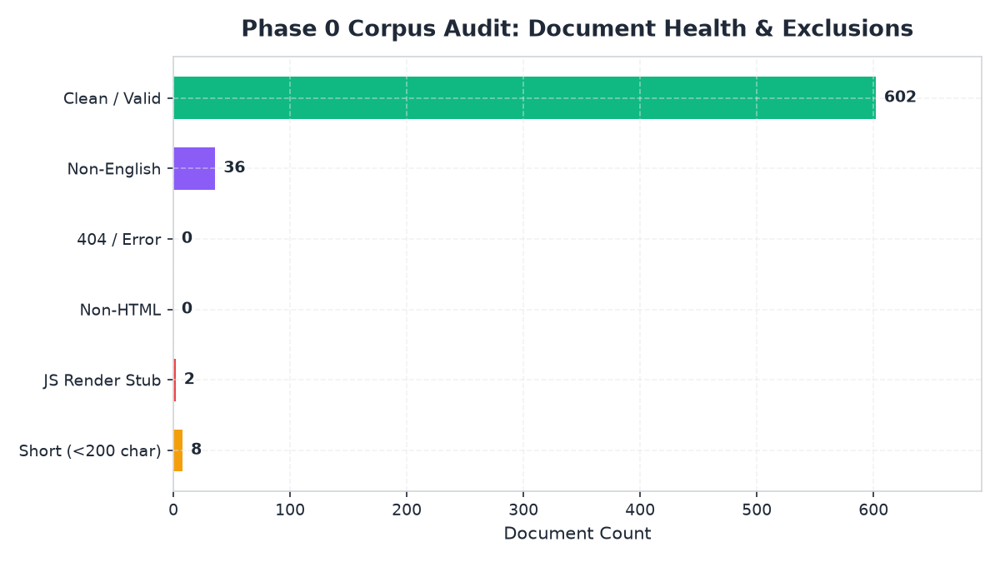
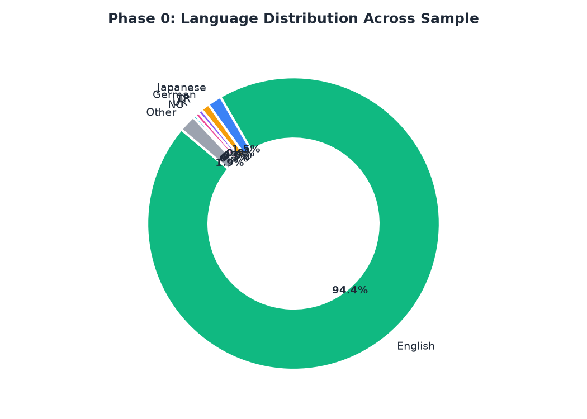
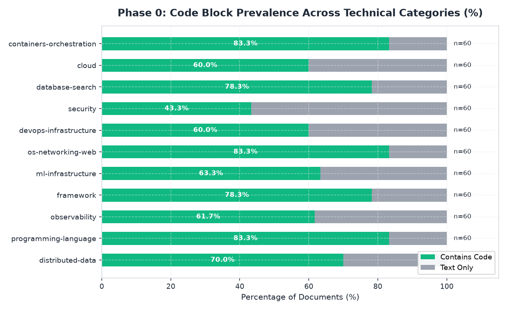
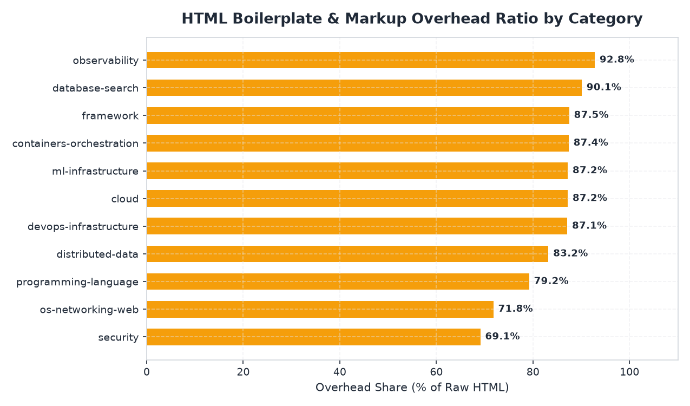
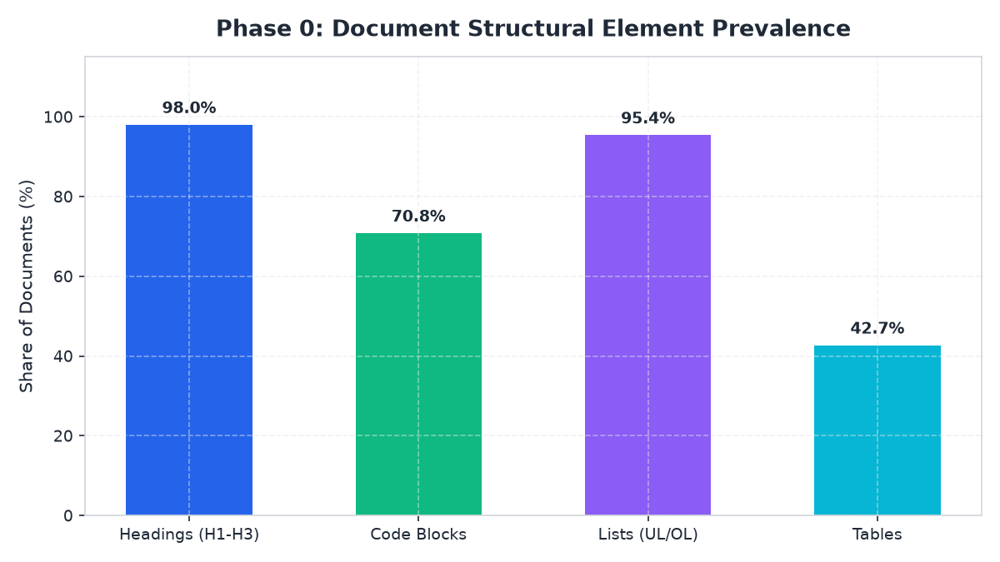
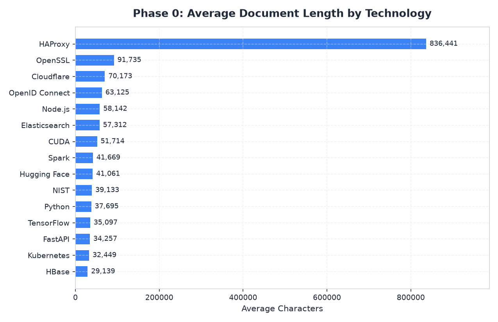

# Phase 0 — Comprehensive Corpus Audit Report

**Sample Size Analyzed:** 648 documents across all 11 technical categories and 76 technologies.
**Balanced Stratification:** Equal representation across technical categories and document types.
**Text-Length Threshold:** < 200 characters.

## Visual Charts & Analytics

### 1. Document Health & Exclusions

### 2. Language Distribution

### 3. Code vs. Text-Only Prevalence Across Categories

### 4. HTML Boilerplate Overhead by Category

### 5. Document Structural Element Prevalence

### 6. Document Lengths Across Technologies

---

## 1. Exclusion Categories Summary

| Exclusion Category | Flagged Count | Sample Share | Example Doc IDs |
| :--- | :--- | :--- | :--- |
| **Empty / Short Body (<200 chars)** | 8 | 1.23% | document_067893, document_068246, document_068276, document_067930, document_068040 |
| **Client-Side JS Render Stubs** | 2 | 0.31% | document_005235, document_007015 |
| **Non-HTML Content Mislabeled** | 0 | 0.0% | None |
| **HTTP 200 Error / 404 Pages** | 0 | 0.0% | None |
| **Non-English Documents** | 36 | 5.56% | document_055009, document_042449, document_039559, document_042675, document_009982 |
| **Clean / Valid Documents** | 602 | 92.9% | — |

---

## 2. Language Breakdown & Multilingual Sources

| Language | Document Count | Share (%) |
| :--- | :--- | :--- |
| **English** | 612 | 94.4% |
| **Japanese** | 10 | 1.5% |
| **German** | 6 | 0.9% |
| **TR** | 3 | 0.5% |
| **UK** | 3 | 0.5% |
| **NO** | 2 | 0.3% |
| **Italian** | 2 | 0.3% |
| **RO** | 2 | 0.3% |
| **Portuguese** | 2 | 0.3% |
| **VI** | 1 | 0.2% |
| **Korean** | 1 | 0.2% |
| **French** | 1 | 0.2% |
| **Russian** | 1 | 0.2% |
| **AR** | 1 | 0.2% |
| **BN** | 1 | 0.2% |

### Key Non-English Sources Detected
| Doc ID | Technology | Category | Detected Language | Title |
| :--- | :--- | :--- | :--- | :--- |
| `document_055009` | GitLab | devops-infrastructure | Japanese | インテグレーション | GitLab Docs |
| `document_042449` | Google Cloud | cloud | VI | 使用服务账号模拟 | Authentication | Google Cloud |
| `document_039559` | AWS | cloud | NO | api-gw-stage-tagged - AWS Config |
| `document_042675` | Google Cloud | cloud | German | Datenlöschung auf Google Cloud | Securit |
| `document_009982` | FastAPI | framework | TR | Query Parameter Modelleri - FastAPI |
| `document_074179` | TensorFlow | ml-infrastructure | Italian | Utilizzo del formato SavedModel | Tensor |
| `document_001128` | Java | programming-language | Japanese | クラスjavax.swing.plaf.synth.SynthTreeUIの使用 |
| `document_009805` | FastAPI | framework | UK | Reference - FastAPI |

---

## 3. Code vs. Text Presence by Category

| Technical Category | Sample Docs | With Code (%) | Total Code Blocks | Avg Code Chars |
| :--- | :--- | :--- | :--- | :--- |
| **distributed-data** | 60 | 70.0% | 590 | 1785.9 |
| **programming-language** | 60 | 83.3% | 867 | 2887.5 |
| **observability** | 60 | 61.7% | 849 | 4553.9 |
| **framework** | 60 | 78.3% | 1487 | 6892.7 |
| **ml-infrastructure** | 60 | 63.3% | 1034 | 6049.2 |
| **os-networking-web** | 60 | 83.3% | 10336 | 129060.2 |
| **devops-infrastructure** | 60 | 60.0% | 740 | 2154.9 |
| **security** | 60 | 43.3% | 500 | 8396.5 |
| **database-search** | 60 | 78.3% | 392 | 1413.0 |
| **cloud** | 60 | 60.0% | 338 | 1395.8 |
| **containers-orchestration** | 60 | 83.3% | 502 | 1799.0 |

---

## 4. DOM Complexity & Structural Richness

- **Documents with Heading Hierarchy (H1-H3):** 98.0%
- **Documents with Isolated Code Blocks:** 70.8%
- **Documents with Structured Lists (UL/OL):** 95.4%
- **Documents with Tables:** 42.7%

---

## 5. Near-Duplicate Analysis (SimHash Clustering)

- **Documents Analyzed for Near-Duplicates:** 640
- **Near-Duplicate Clusters Found:** 8
- **Total Documents in Duplicate Clusters:** 21

### Top Near-Duplicate Cluster Samples

* **Cluster 1** (3 docs) — Representative: `document_047117` (`Get script content | Cloudflare API`)
  - Members: document_047117, document_046227, document_046559
* **Cluster 2** (2 docs) — Representative: `document_036999` (`Structured Streaming - Apache Iceberg™`)
  - Members: document_036999, document_037147
* **Cluster 3** (5 docs) — Representative: `document_077270` (`nvmath.bindings.cusolverDn.create_params — nvmath-python`)
  - Members: document_077270, document_078038, document_077249, document_078932, document_078738
* **Cluster 4** (3 docs) — Representative: `document_012847` (`Streams Redirect | Apache Kafka`)
  - Members: document_012847, document_012849, document_012848
* **Cluster 5** (2 docs) — Representative: `document_076562` (`VALID_NP_HPARAMS — Ray 2.58.0`)
  - Members: document_076562, document_076102

---

## 6. Recommendations for Human Sign-off

1. **Short Body Filtering:** Exclude documents with body length < 200 characters (targets empty/broken JS pages without removing concise API reference stubs).
2. **Language Exclusion:** Drop all non-English pages (e.g. Japanese Oracle docs and Chinese tutorials) to maintain search consistency.
3. **Duplicate Collapse:** Retain only the representative document from each SimHash cluster (Hamming distance ≤ 3).
4. **Zone Weighting Strategy (BM25F Preview):** Given that 70%+ of technical documents contain code and 90%+ contain headings, BM25F zone weighting across `title`, `headings`, `body`, and `code` will provide substantial ranking leverage.
