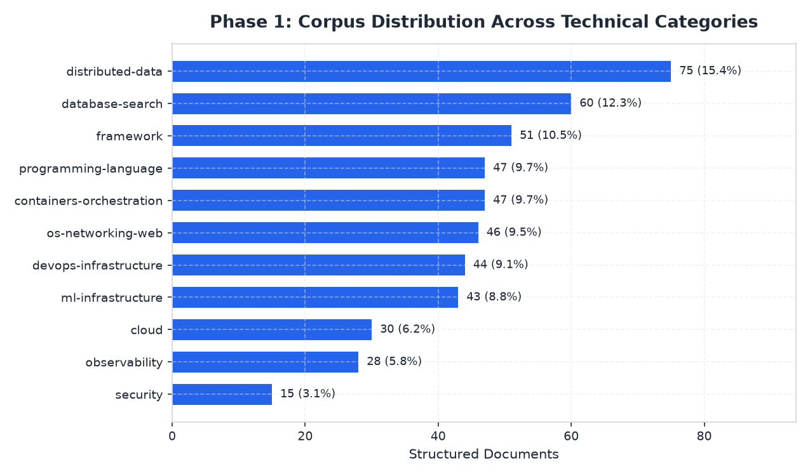
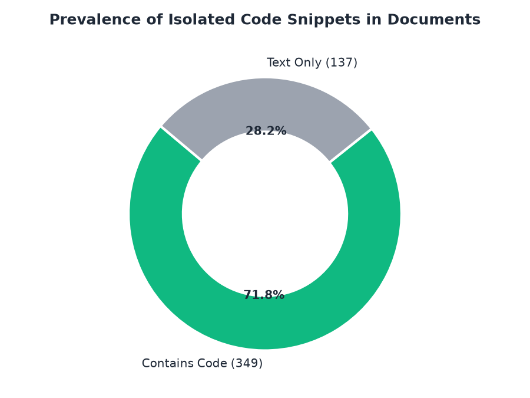
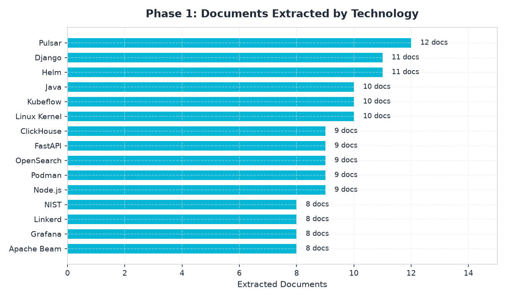

# Phase 1 — Structured Corpus Statistics Report

**Total Structured Documents Processed:** 486
**Average Document Length:** 2,254.2 words (15,787.4 characters)
**Total Vocabulary / Body Words:** 1,095,519

## Visual Charts & Graphs

## 1. Code Block & Technical Token Extraction

- **Documents with Code Blocks:** 349 (71.81%)
- **Total Isolated Code Blocks:** 7,739
- **Average Code Blocks per Document:** 15.92
- **Total Code Snippet Characters:** 4,095,215

## 2. Date Detection & Normalization

- **Documents with Dates Detected:** 52 (10.7%)
- **Total Normalized Dates Extracted:** 125

### Top Normalized Dates Detected

| Date (ISO) | Document Frequency |
| :--- | :--- |
| `2026-08-13` | 7 |
| `2025-11-17` | 5 |
| `2023-11-20` | 4 |
| `2026-06-29` | 4 |
| `2017-09-22` | 4 |
| `2014-12-17` | 3 |
| `2018-06-21` | 3 |
| `2021-03-15` | 3 |

## 3. Category Breakdown

| Category | Documents | Share |
| :--- | :--- | :--- |
| **programming-language** | 47 | 9.7% |
| **framework** | 51 | 10.5% |
| **os-networking-web** | 46 | 9.5% |
| **security** | 15 | 3.1% |
| **ml-infrastructure** | 43 | 8.8% |
| **database-search** | 60 | 12.3% |
| **containers-orchestration** | 47 | 9.7% |
| **observability** | 28 | 5.8% |
| **cloud** | 30 | 6.2% |
| **distributed-data** | 75 | 15.4% |
| **devops-infrastructure** | 44 | 9.1% |

## 4. Technology Breakdown (Top 20 by Volume)

| Technology | Docs | Avg Words | Avg Chars | Code Blocks | Dates |
| :--- | :--- | :--- | :--- | :--- | :--- |
| Pulsar | 12 | 672.8 | 5031.2 | 112 | 0 |
| Django | 11 | 587.6 | 4785.6 | 18 | 4 |
| Helm | 11 | 495.0 | 3632.4 | 48 | 0 |
| Java | 10 | 278.3 | 2916.9 | 58 | 0 |
| Kubeflow | 10 | 751.3 | 5348.5 | 72 | 1 |
| Linux Kernel | 10 | 695.4 | 4402.6 | 19 | 0 |
| ClickHouse | 9 | 469.4 | 3029.7 | 93 | 0 |
| FastAPI | 9 | 3369.2 | 33402.1 | 239 | 0 |
| OpenSearch | 9 | 615.7 | 4404.6 | 50 | 0 |
| Podman | 9 | 762.8 | 5566.8 | 40 | 0 |
| Node.js | 9 | 9123.2 | 67340.0 | 343 | 0 |
| NIST | 8 | 1303.1 | 15654.8 | 0 | 0 |
| Linkerd | 8 | 666.5 | 4406.2 | 12 | 3 |
| Grafana | 8 | 646.5 | 4588.2 | 31 | 2 |
| Apache Beam | 8 | 988.5 | 6770.1 | 53 | 6 |
| Hadoop | 8 | 322.2 | 2953.4 | 90 | 0 |
| Neo4j | 8 | 1633.6 | 10043.0 | 95 | 1 |
| Go | 8 | 7282.8 | 50486.5 | 147 | 12 |
| MySQL | 8 | 722.6 | 5574.6 | 7 | 0 |
| Spring Boot | 7 | 169.9 | 1600.9 | 33 | 0 |