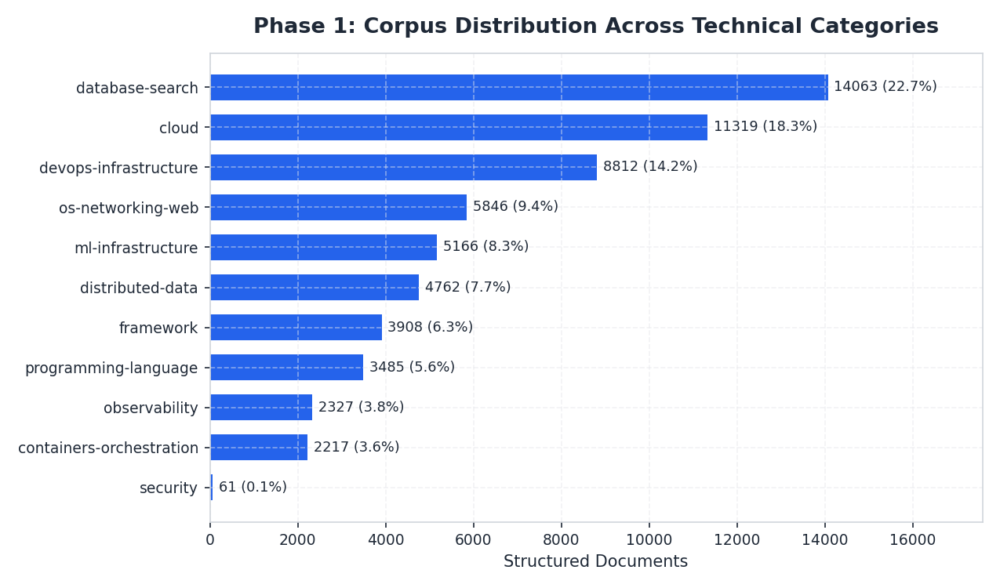
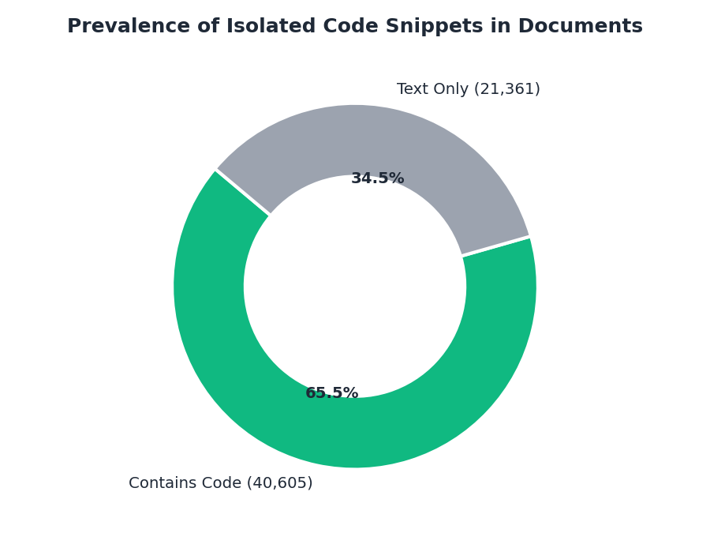
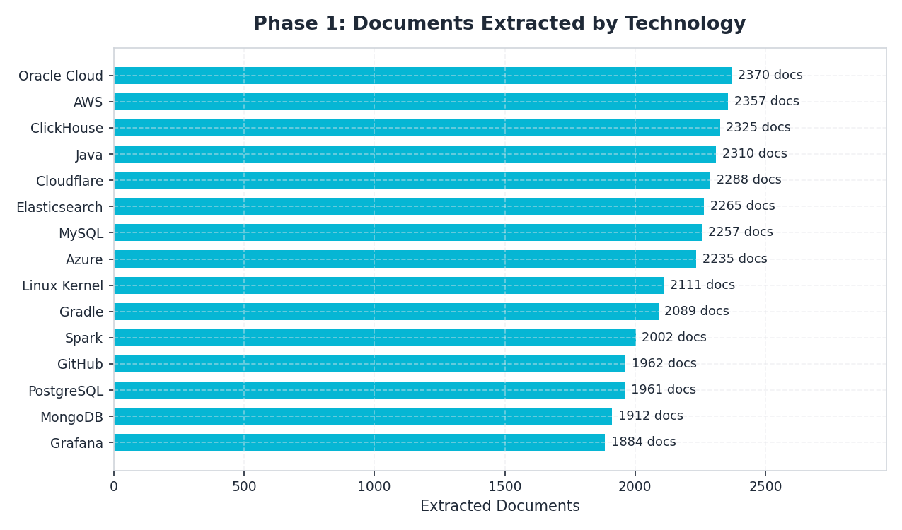

# Phase 1 — Structured Corpus Statistics Report

**Total Structured Documents Processed:** 61,966
**Average Document Length:** 977.3 words (7,380.8 characters)
**Total Vocabulary / Body Words:** 60,561,032

## Visual Charts & Graphs

## 1. Code Block & Technical Token Extraction

- **Documents with Code Blocks:** 40,605 (65.53%)
- **Total Isolated Code Blocks:** 369,452
- **Average Code Blocks per Document:** 5.96
- **Total Code Snippet Characters:** 116,611,052

## 2. Date Detection & Normalization

- **Documents with Dates Detected:** 7,679 (12.39%)
- **Total Normalized Dates Extracted:** 11,624

### Top Normalized Dates Detected

| Date (ISO) | Document Frequency |
| :--- | :--- |
| `2026-08-13` | 1,880 |
| `2026-09-01` | 216 |
| `2026-08-03` | 203 |
| `2026-08-07` | 164 |
| `2023-01-01` | 158 |
| `2026-07-13` | 152 |
| `2025-11-01` | 136 |
| `2014-12-17` | 122 |

## 3. Category Breakdown

| Category | Documents | Share |
| :--- | :--- | :--- |
| **programming-language** | 3,485 | 5.6% |
| **framework** | 3,908 | 6.3% |
| **containers-orchestration** | 2,217 | 3.6% |
| **distributed-data** | 4,762 | 7.7% |
| **database-search** | 14,063 | 22.7% |
| **cloud** | 11,319 | 18.3% |
| **devops-infrastructure** | 8,812 | 14.2% |
| **os-networking-web** | 5,846 | 9.4% |
| **observability** | 2,327 | 3.8% |
| **security** | 61 | 0.1% |
| **ml-infrastructure** | 5,166 | 8.3% |

## 4. Technology Breakdown (Top 20 by Volume)

| Technology | Docs | Avg Words | Avg Chars | Code Blocks | Dates |
| :--- | :--- | :--- | :--- | :--- | :--- |
| Oracle Cloud | 2,370 | 485.1 | 4793.6 | 21,498 | 98 |
| AWS | 2,357 | 654.1 | 5386.3 | 10,947 | 226 |
| ClickHouse | 2,325 | 586.1 | 4564.2 | 25,203 | 417 |
| Java | 2,310 | 649.2 | 6567.1 | 17,681 | 13 |
| Cloudflare | 2,288 | 429.5 | 3263.4 | 7,203 | 109 |
| Elasticsearch | 2,265 | 847.4 | 6348.2 | 9,136 | 239 |
| MySQL | 2,257 | 716.1 | 5594.3 | 5,797 | 250 |
| Azure | 2,235 | 1963.0 | 13695.8 | 14,626 | 729 |
| Linux Kernel | 2,111 | 1334.3 | 9211.5 | 8,398 | 82 |
| Gradle | 2,089 | 163.5 | 1222.7 | 2,068 | 2 |
| Spark | 2,002 | 551.0 | 4753.7 | 11,818 | 164 |
| GitHub | 1,962 | 987.2 | 7480.0 | 9,781 | 475 |
| PostgreSQL | 1,961 | 924.2 | 5857.4 | 6,312 | 2079 |
| MongoDB | 1,912 | 708.5 | 5080.3 | 10,081 | 559 |
| Grafana | 1,884 | 835.9 | 6021.9 | 7,782 | 212 |
| GitLab | 1,865 | 920.4 | 7583.4 | 14,480 | 146 |
| CUDA | 1,788 | 1556.9 | 11400.6 | 7,468 | 116 |
| Hadoop | 1,693 | 601.1 | 5238.7 | 12,823 | 71 |
| Maven | 1,544 | 321.9 | 3156.7 | 4,869 | 27 |
| Envoy | 1,488 | 482.5 | 3674.9 | 3,613 | 416 |