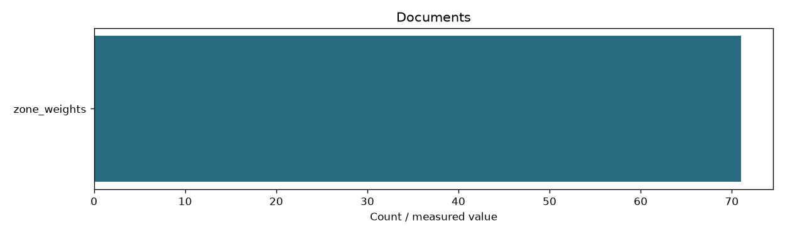

# Learning document references

```json
{
  "datasets": {
    "zone_weights": {
      "documents": 71,
      "bytes": 3338088,
      "directory": "data/step_04_weights/documents"
    }
  },
  "unique_documents": 71,
  "source": "Full extracted source text from SQLite; these files are for reference, not model inputs"
}
```

