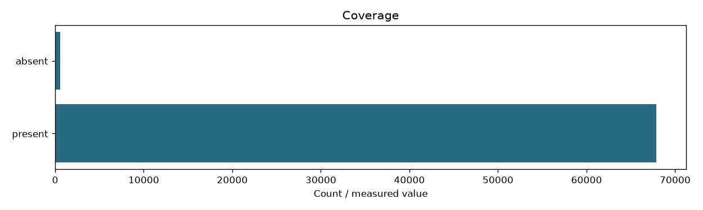

# Passages

```json
{
  "content_sha256": "7ce36b0880254cec449fd8bfb8292bb526115103956764bc9be51b1bc2faaecf",
  "fingerprint": "59e9e37e51079a9ca0354fde2f77967c97b6d83a6fd7fe8d0b451863dcba0c8a",
  "documents": 68414,
  "passages": 255445,
  "zone": "body",
  "input_fingerprint": "f15488c8b98dc3f6f7f38152db2226dfef073173cd184609831edea290884f26",
  "documents_present": 67867
}
```

