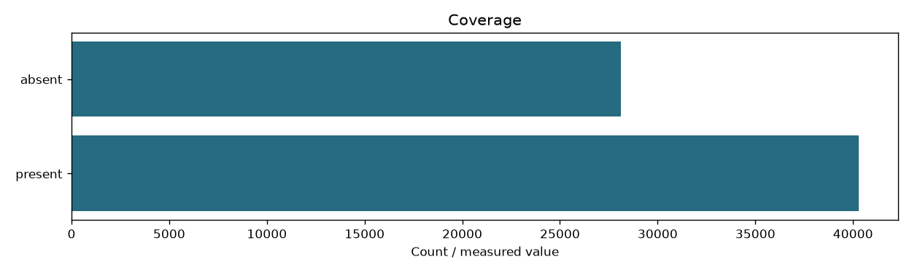

# Passages

```json
{
  "content_sha256": "ae3936081ea430a0a67740715934e418ce5b59711e08e8cc194011e7e8800930",
  "fingerprint": "fac014e30dcee5b06352befa8d7cfc921b7c48bba9476caf57c2cb84dd574b19",
  "documents": 68414,
  "passages": 91536,
  "zone": "code",
  "input_fingerprint": "f15488c8b98dc3f6f7f38152db2226dfef073173cd184609831edea290884f26",
  "documents_present": 40303
}
```

