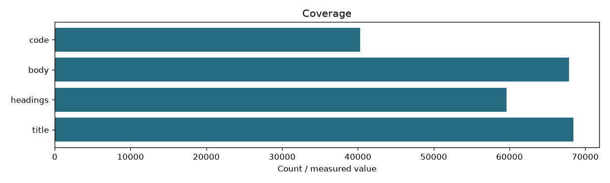
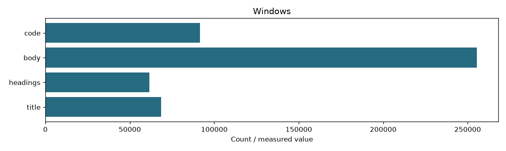

# Step 02 Windows

```json
{
  "fingerprint": "4217438d8fd32410fd22acf441c1c5403837c0fbb26a0f85edbdf1633eae0790",
  "documents": 68414,
  "windows": {
    "title": 68414,
    "headings": 61511,
    "body": 255445,
    "code": 91536
  },
  "zone_coverage": {
    "title": 68414,
    "headings": 59579,
    "body": 67867,
    "code": 40303
  },
  "zones": [
    "title",
    "headings",
    "body",
    "code"
  ],
  "content_tokens": 496,
  "overlap": 64,
  "source_fingerprint": "f15488c8b98dc3f6f7f38152db2226dfef073173cd184609831edea290884f26"
}
```



