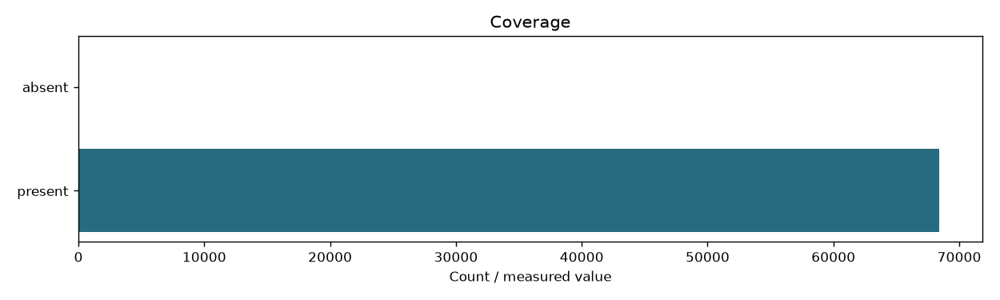

# Passages

```json
{
  "content_sha256": "37261e9e21c8e8dea1f1dacdddd87f7e005c3f9e00b513bf2239536406ea77ec",
  "fingerprint": "71668d940cb276669256315dcfd18c9f2536f5d3b8c3044b085a1a50be45531c",
  "documents": 68414,
  "passages": 68414,
  "zone": "title",
  "input_fingerprint": "f15488c8b98dc3f6f7f38152db2226dfef073173cd184609831edea290884f26",
  "documents_present": 68414
}
```

