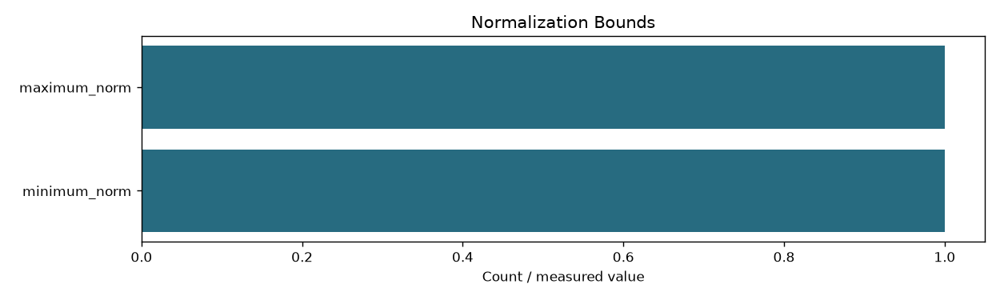
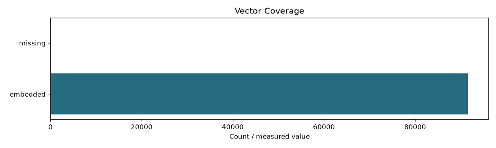

# Code

```json
{
  "fingerprint": "ceb0fc1a0bf9baa0602b902e38ceb66cb529609c8bf433a36dcd7841f865cf38",
  "input_fingerprint": "fac014e30dcee5b06352befa8d7cfc921b7c48bba9476caf57c2cb84dd574b19",
  "documents": 68414,
  "passages": 91536,
  "dimension": 1024,
  "dtype": "float16",
  "model_revision": "97b0c614be4d77ee51c0cef4e5f07c00f9eb65b3",
  "all_vectors_finite": true,
  "norm_min": 0.9997583031654358,
  "norm_max": 1.0002418756484985,
  "vector_bytes": 187465856,
  "last_session_seconds": 1473.29,
  "last_session_rows": 91536,
  "device": "cuda",
  "final_batch_size": 512,
  "max_batch_tokens": 100000,
  "peak_cuda_allocated_bytes": 5066192384
}
```



