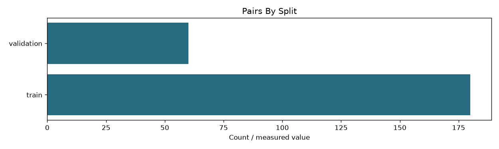

# Full-index zone learning features

```json
{
  "pairs": 240,
  "queries": 60,
  "index_fingerprint": "6243a1e92060be87bf31c54ccd305fb375d9d3482a75b317b51886ef24f198cf",
  "training_csv_sha256": "86c856c863c19dc1c63de31a7063a3f57ef0865afb95d3eb3230cfb7af66e33d"
}
```

