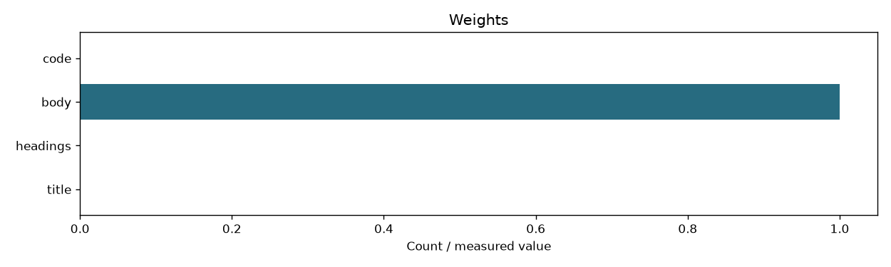
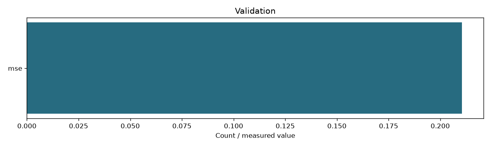

# 04 Learned zone weights

```json
{
  "zones": [
    "title",
    "headings",
    "body",
    "code"
  ],
  "weights": [
    0.0,
    0.0,
    1.0,
    0.0
  ],
  "index_fingerprint": "4217438d8fd32410fd22acf441c1c5403837c0fbb26a0f85edbdf1633eae0790",
  "training_csv_sha256": "e7bfe4179874a20cb35762d3acb723e9172f4dbc8f08da4293e590f5b85341fc",
  "objective": "training-only squared error to binary relevance; deterministic simplex grid step 0.05",
  "missing_zone_policy": "renormalize over present zones; equal-present fallback when all present weights are zero",
  "evaluation": {
    "train": {
      "mse": 0.15165827282834723,
      "queries": 33
    },
    "validation": {
      "mse": 0.21046303331293797,
      "queries": 11
    }
  },
  "judgment_scope": "Small judged development pools, not final retrieval evaluation"
}
```



