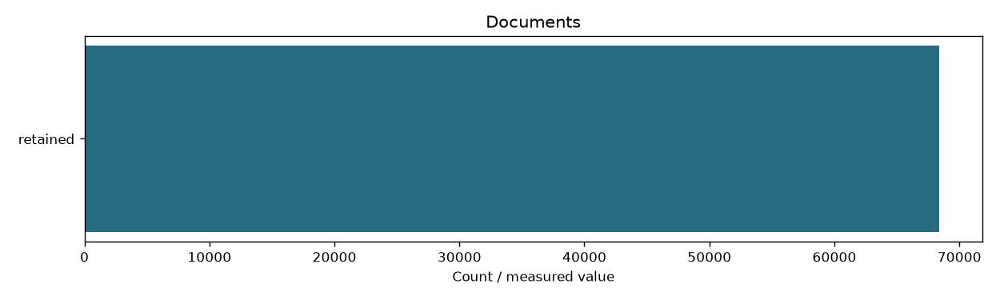

# Corrected corpus ZIP

```json
{
  "documents": 68414,
  "all_files_sha256_verified": true,
  "manifest_sha256": "20cc401c26cf7144238dd0d55826ed39741ff58600f13235c2f7d80237dfe02a",
  "categories": {
    "programming-language": 2127,
    "framework": 5259,
    "containers-orchestration": 2786,
    "distributed-data": 6134,
    "database-search": 15667,
    "cloud": 10123,
    "devops-infrastructure": 9430,
    "os-networking-web": 6940,
    "observability": 3035,
    "security": 62,
    "ml-infrastructure": 6851
  },
  "technologies": {
    "Java": 925,
    "Python": 241,
    "Go": 28,
    "Rust": 300,
    "JavaScript": 441,
    "TypeScript": 49,
    "Kotlin": 143,
    "Spring": 110,
    "Spring Boot": 1222,
    "React": 142,
    "Angular": 1321,
    "Node.js": 38,
    "Django": 2377,
    "FastAPI": 49,
    "Docker": 470,
    "Kubernetes": 1223,
    "Helm": 159,
    "Podman": 388,
    "OpenShift": 1,
    "Istio": 217,
    "Linkerd": 328,
    "Kafka": 3,
    "Spark": 2312,
    "Hadoop": 2314,
    "Hive": 88,
    "HBase": 11,
    "Cassandra": 49,
    "ZooKeeper": 637,
    "Pulsar": 162,
    "RabbitMQ": 264,
    "gRPC": 31,
    "Apache Beam": 54,
    "PostgreSQL": 2440,
    "MySQL": 2280,
    "MongoDB": 2366,
    "Redis": 2428,
    "Elasticsearch": 2440,
    "OpenSearch": 2310,
    "Neo4j": 796,
    "ClickHouse": 607,
    "Apache Iceberg": 209,
    "AWS": 1461,
    "Azure": 2301,
    "Google Cloud": 141,
    "Oracle Cloud": 2402,
    "Cloudflare": 2401,
    "DigitalOcean": 1417,
    "Git": 988,
    "GitHub": 2393,
    "GitLab": 966,
    "Jenkins": 177,
    "Terraform": 601,
    "Vault": 365,
    "Maven": 1521,
    "Gradle": 2419,
    "Linux Kernel": 2284,
    "Nginx": 46,
    "Apache HTTP Server": 456,
    "HAProxy": 9,
    "Envoy": 2401,
    "OpenSSL": 1341,
    "RFCs": 403,
    "Prometheus": 108,
    "Grafana": 2239,
    "OpenTelemetry": 259,
    "Jaeger": 429,
    "OWASP": 1,
    "OpenID Connect": 32,
    "NIST": 29,
    "PyTorch": 1946,
    "TensorFlow": 36,
    "Hugging Face": 968,
    "MLflow": 94,
    "Ray": 1135,
    "Kubeflow": 474,
    "CUDA": 2198
  },
  "zip_bytes": 2130610566,
  "zip_sha256": "c2aafc3a882fac0eb6dfb26242d7b62fec24a528f05b2b0b8d9eb7b52880c963"
}
```

