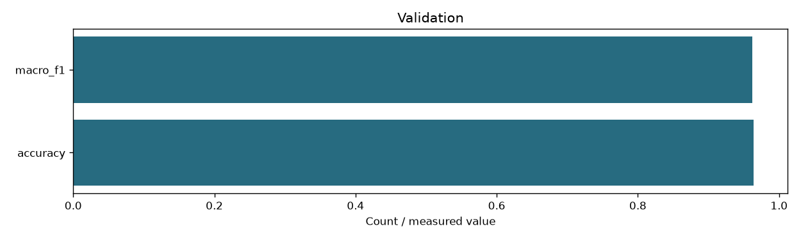

# Content centroid classification

```json
{
  "schema": "content-centroid-v2",
  "index_fingerprint": "6243a1e92060be87bf31c54ccd305fb375d9d3482a75b317b51886ef24f198cf",
  "classes": [
    "C01",
    "C02",
    "C03",
    "C04",
    "C05",
    "C06",
    "C07",
    "C08",
    "C09",
    "C10",
    "C11",
    "C12",
    "C13",
    "C14"
  ],
  "class_names": {
    "C01": "cloud-platforms",
    "C02": "ai-ml-compute",
    "C03": "mlops-orchestration",
    "C04": "programming-languages",
    "C05": "databases-storage",
    "C06": "search-engines",
    "C07": "messaging-rpc",
    "C08": "distributed-data-processing",
    "C09": "application-frameworks",
    "C10": "containers-orchestration",
    "C11": "devops-build-release",
    "C12": "os-networking-web",
    "C13": "security-identity",
    "C14": "observability"
  },
  "training_csv_sha256": "eec3f80cecdace1470e4aeee2fbcafb3fc88e5ea62a8ce987c35c971d4b8f1d9",
  "classes_sha256": "edd68eb1ff4a87d1313f73a4a6539a95c62ea44288f6f5f2dc29e85340026056",
  "training_documents": 140,
  "validation": {
    "accuracy": 0.9642857142857143,
    "macro_f1": 0.9619047619047619,
    "per_class_f1": [
      0.8,
      1.0,
      1.0,
      1.0,
      1.0,
      1.0,
      1.0,
      1.0,
      1.0,
      1.0,
      0.6666666666666666,
      1.0,
      1.0,
      1.0
    ],
    "confusion": [
      [
        2,
        0,
        0,
        0,
        0,
        0,
        0,
        0,
        0,
        0,
        0,
        0,
        0,
        0
      ],
      [
        0,
        2,
        0,
        0,
        0,
        0,
        0,
        0,
        0,
        0,
        0,
        0,
        0,
        0
      ],
      [
        0,
        0,
        2,
        0,
        0,
        0,
        0,
        0,
        0,
        0,
        0,
        0,
        0,
        0
      ],
      [
        0,
        0,
        0,
        2,
        0,
        0,
        0,
        0,
        0,
        0,
        0,
        0,
        0,
        0
      ],
      [
        0,
        0,
        0,
        0,
        2,
        0,
        0,
        0,
        0,
        0,
        0,
        0,
        0,
        0
      ],
      [
        0,
        0,
        0,
        0,
        0,
        2,
        0,
        0,
        0,
        0,
        0,
        0,
        0,
        0
      ],
      [
        0,
        0,
        0,
        0,
        0,
        0,
        2,
        0,
        0,
        0,
        0,
        0,
        0,
        0
      ],
      [
        0,
        0,
        0,
        0,
        0,
        0,
        0,
        2,
        0,
        0,
        0,
        0,
        0,
        0
      ],
      [
        0,
        0,
        0,
        0,
        0,
        0,
        0,
        0,
        2,
        0,
        0,
        0,
        0,
        0
      ],
      [
        0,
        0,
        0,
        0,
        0,
        0,
        0,
        0,
        0,
        2,
        0,
        0,
        0,
        0
      ],
      [
        1,
        0,
        0,
        0,
        0,
        0,
        0,
        0,
        0,
        0,
        1,
        0,
        0,
        0
      ],
      [
        0,
        0,
        0,
        0,
        0,
        0,
        0,
        0,
        0,
        0,
        0,
        2,
        0,
        0
      ],
      [
        0,
        0,
        0,
        0,
        0,
        0,
        0,
        0,
        0,
        0,
        0,
        0,
        2,
        0
      ],
      [
        0,
        0,
        0,
        0,
        0,
        0,
        0,
        0,
        0,
        0,
        0,
        0,
        0,
        2
      ]
    ],
    "documents": 28
  },
  "secondary_margin": 0.03,
  "max_memberships": 2,
  "document_representation": "Equal available-zone normalized means of normalized windows",
  "label_scope": "Reviewed primary content classes; secondary membership is a similarity heuristic",
  "documents": 68414,
  "memberships": 88178
}
```


