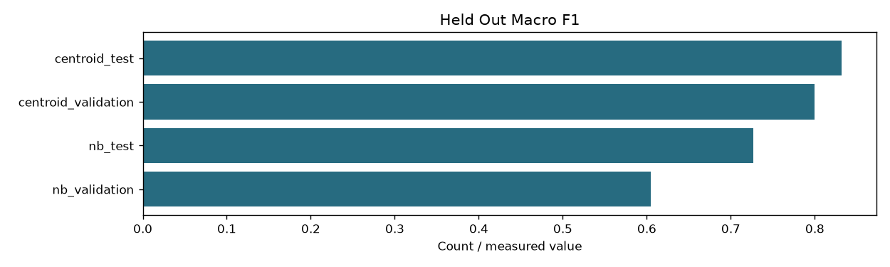

# 05 Classification training

```json
{
  "index_fingerprint": "4217438d8fd32410fd22acf441c1c5403837c0fbb26a0f85edbdf1633eae0790",
  "classes": [
    "C01",
    "C02",
    "C03",
    "C04",
    "C05",
    "C06",
    "C07",
    "C08",
    "C09",
    "C10",
    "C11",
    "C12",
    "C13",
    "C14"
  ],
  "class_names": {
    "C01": "cloud-platforms",
    "C02": "ai-ml-compute",
    "C03": "mlops-orchestration",
    "C04": "programming-languages",
    "C05": "databases-storage",
    "C06": "search-engines",
    "C07": "messaging-rpc",
    "C08": "distributed-data-processing",
    "C09": "application-frameworks",
    "C10": "containers-orchestration",
    "C11": "devops-build-release",
    "C12": "os-networking-web",
    "C13": "security-identity",
    "C14": "observability"
  },
  "training_csv_sha256": "e9ff13c8df76535b2838baa4139264dfe1abd5a37583331bbba731a2409203bf",
  "vocabulary_size": 8147,
  "training_documents": 280,
  "nb": "Multinomial token counts, training-only vocabulary with df>=2, add-one smoothing and empirical class priors",
  "centroid": "Mean of normalized training-document vectors; each document averages all pure-zone windows",
  "input_policy": "Original source text only; no added technology/class/URL metadata",
  "label_scope": "Source-domain classification; held-out scores do not validate semantic relevance or short-query routing",
  "results": {
    "nb": {
      "validation": {
        "accuracy": 0.6142857142857143,
        "macro_f1": 0.6046306867735439,
        "per_class_f1": [
          0.3333333333333333,
          0.75,
          0.6666666666666666,
          0.5454545454545454,
          0.25,
          0.8888888888888888,
          0.7142857142857143,
          0.6666666666666666,
          0.7692307692307693,
          0.5,
          0.36363636363636365,
          0.6,
          0.75,
          0.6666666666666666
        ],
        "confusion": [
          [
            1,
            0,
            0,
            0,
            0,
            0,
            0,
            0,
            1,
            1,
            1,
            0,
            0,
            1
          ],
          [
            0,
            3,
            1,
            1,
            0,
            0,
            0,
            0,
            0,
            0,
            0,
            0,
            0,
            0
          ],
          [
            0,
            0,
            3,
            0,
            0,
            0,
            0,
            0,
            0,
            1,
            0,
            0,
            0,
            1
          ],
          [
            0,
            0,
            0,
            3,
            0,
            0,
            0,
            0,
            1,
            0,
            1,
            0,
            0,
            0
          ],
          [
            0,
            0,
            0,
            0,
            1,
            0,
            1,
            1,
            1,
            1,
            0,
            0,
            0,
            0
          ],
          [
            0,
            0,
            0,
            0,
            0,
            4,
            0,
            0,
            0,
            0,
            1,
            0,
            0,
            0
          ],
          [
            0,
            0,
            0,
            0,
            0,
            0,
            5,
            0,
            0,
            0,
            0,
            0,
            0,
            0
          ],
          [
            0,
            0,
            0,
            1,
            1,
            0,
            0,
            3,
            0,
            0,
            0,
            0,
            0,
            0
          ],
          [
            0,
            0,
            0,
            0,
            0,
            0,
            0,
            0,
            5,
            0,
            0,
            0,
            0,
            0
          ],
          [
            0,
            0,
            0,
            0,
            0,
            0,
            0,
            0,
            0,
            3,
            1,
            1,
            0,
            0
          ],
          [
            0,
            0,
            0,
            1,
            0,
            0,
            1,
            0,
            0,
            1,
            2,
            0,
            0,
            0
          ],
          [
            0,
            0,
            0,
            0,
            0,
            0,
            1,
            0,
            0,
            0,
            0,
            3,
            0,
            1
          ],
          [
            0,
            0,
            0,
            0,
            1,
            0,
            0,
            0,
            0,
            0,
            0,
            1,
            3,
            0
          ],
          [
            0,
            0,
            0,
            0,
            0,
            0,
            1,
            0,
            0,
            0,
            0,
            0,
            0,
            4
          ]
        ],
        "documents": 70
      },
      "test": {
        "accuracy": 0.7428571428571429,
        "macro_f1": 0.7265203050917337,
        "per_class_f1": [
          0.3333333333333333,
          0.8888888888888888,
          0.8888888888888888,
          0.7142857142857143,
          0.5714285714285714,
          0.6,
          0.7272727272727273,
          0.9090909090909091,
          0.8333333333333334,
          1.0,
          0.8,
          0.6666666666666666,
          0.5714285714285714,
          0.6666666666666666
        ],
        "confusion": [
          [
            1,
            0,
            0,
            0,
            0,
            1,
            0,
            0,
            0,
            0,
            1,
            0,
            0,
            2
          ],
          [
            0,
            4,
            0,
            1,
            0,
            0,
            0,
            0,
            0,
            0,
            0,
            0,
            0,
            0
          ],
          [
            0,
            0,
            4,
            0,
            0,
            0,
            0,
            0,
            1,
            0,
            0,
            0,
            0,
            0
          ],
          [
            0,
            0,
            0,
            5,
            0,
            0,
            0,
            0,
            0,
            0,
            0,
            0,
            0,
            0
          ],
          [
            0,
            0,
            0,
            1,
            2,
            1,
            0,
            0,
            1,
            0,
            0,
            0,
            0,
            0
          ],
          [
            0,
            0,
            0,
            0,
            0,
            3,
            1,
            0,
            0,
            0,
            0,
            0,
            0,
            1
          ],
          [
            0,
            0,
            0,
            0,
            0,
            0,
            4,
            1,
            0,
            0,
            0,
            0,
            0,
            0
          ],
          [
            0,
            0,
            0,
            0,
            0,
            0,
            0,
            5,
            0,
            0,
            0,
            0,
            0,
            0
          ],
          [
            0,
            0,
            0,
            0,
            0,
            0,
            0,
            0,
            5,
            0,
            0,
            0,
            0,
            0
          ],
          [
            0,
            0,
            0,
            0,
            0,
            0,
            0,
            0,
            0,
            5,
            0,
            0,
            0,
            0
          ],
          [
            0,
            0,
            0,
            0,
            0,
            0,
            0,
            0,
            0,
            0,
            4,
            0,
            0,
            1
          ],
          [
            0,
            0,
            0,
            1,
            0,
            0,
            0,
            0,
            0,
            0,
            0,
            3,
            0,
            1
          ],
          [
            0,
            0,
            0,
            1,
            0,
            0,
            1,
            0,
            0,
            0,
            0,
            1,
            2,
            0
          ],
          [
            0,
            0,
            0,
            0,
            0,
            0,
            0,
            0,
            0,
            0,
            0,
            0,
            0,
            5
          ]
        ],
        "documents": 70
      }
    },
    "centroid": {
      "validation": {
        "accuracy": 0.8,
        "macro_f1": 0.7996392496392496,
        "per_class_f1": [
          0.6,
          0.8888888888888888,
          0.8,
          0.75,
          0.7272727272727273,
          1.0,
          0.9090909090909091,
          1.0,
          0.75,
          0.9090909090909091,
          0.6666666666666666,
          0.7272727272727273,
          0.6666666666666666,
          0.8
        ],
        "confusion": [
          [
            3,
            0,
            0,
            0,
            0,
            0,
            1,
            0,
            0,
            0,
            1,
            0,
            0,
            0
          ],
          [
            0,
            4,
            1,
            0,
            0,
            0,
            0,
            0,
            0,
            0,
            0,
            0,
            0,
            0
          ],
          [
            0,
            0,
            4,
            0,
            0,
            0,
            0,
            0,
            0,
            1,
            0,
            0,
            0,
            0
          ],
          [
            0,
            0,
            0,
            3,
            1,
            0,
            0,
            0,
            0,
            0,
            1,
            0,
            0,
            0
          ],
          [
            0,
            0,
            0,
            0,
            4,
            0,
            0,
            0,
            0,
            0,
            1,
            0,
            0,
            0
          ],
          [
            0,
            0,
            0,
            0,
            0,
            5,
            0,
            0,
            0,
            0,
            0,
            0,
            0,
            0
          ],
          [
            0,
            0,
            0,
            0,
            0,
            0,
            5,
            0,
            0,
            0,
            0,
            0,
            0,
            0
          ],
          [
            0,
            0,
            0,
            0,
            0,
            0,
            0,
            5,
            0,
            0,
            0,
            0,
            0,
            0
          ],
          [
            0,
            0,
            0,
            0,
            1,
            0,
            0,
            0,
            3,
            0,
            0,
            1,
            0,
            0
          ],
          [
            0,
            0,
            0,
            0,
            0,
            0,
            0,
            0,
            0,
            5,
            0,
            0,
            0,
            0
          ],
          [
            0,
            0,
            0,
            0,
            0,
            0,
            0,
            0,
            0,
            0,
            4,
            0,
            1,
            0
          ],
          [
            0,
            0,
            0,
            0,
            0,
            0,
            0,
            0,
            0,
            0,
            0,
            4,
            0,
            1
          ],
          [
            1,
            0,
            0,
            0,
            0,
            0,
            0,
            0,
            0,
            0,
            0,
            1,
            3,
            0
          ],
          [
            1,
            0,
            0,
            0,
            0,
            0,
            0,
            0,
            0,
            0,
            0,
            0,
            0,
            4
          ]
        ],
        "documents": 70
      },
      "test": {
        "accuracy": 0.8428571428571429,
        "macro_f1": 0.8320140177283034,
        "per_class_f1": [
          0.6666666666666666,
          0.9090909090909091,
          1.0,
          0.9090909090909091,
          0.9090909090909091,
          0.9090909090909091,
          0.8,
          0.8,
          0.6666666666666666,
          0.8888888888888888,
          0.5714285714285714,
          0.8,
          0.9090909090909091,
          0.9090909090909091
        ],
        "confusion": [
          [
            3,
            0,
            0,
            0,
            0,
            0,
            0,
            0,
            1,
            0,
            0,
            0,
            1,
            0
          ],
          [
            0,
            5,
            0,
            0,
            0,
            0,
            0,
            0,
            0,
            0,
            0,
            0,
            0,
            0
          ],
          [
            0,
            0,
            5,
            0,
            0,
            0,
            0,
            0,
            0,
            0,
            0,
            0,
            0,
            0
          ],
          [
            0,
            0,
            0,
            5,
            0,
            0,
            0,
            0,
            0,
            0,
            0,
            0,
            0,
            0
          ],
          [
            0,
            0,
            0,
            0,
            5,
            0,
            0,
            0,
            0,
            0,
            0,
            0,
            0,
            0
          ],
          [
            0,
            0,
            0,
            0,
            0,
            5,
            0,
            0,
            0,
            0,
            0,
            0,
            0,
            0
          ],
          [
            0,
            0,
            0,
            0,
            0,
            0,
            4,
            1,
            0,
            0,
            0,
            0,
            0,
            0
          ],
          [
            0,
            0,
            0,
            0,
            0,
            0,
            1,
            4,
            0,
            0,
            0,
            0,
            0,
            0
          ],
          [
            0,
            0,
            0,
            1,
            1,
            0,
            0,
            0,
            3,
            0,
            0,
            0,
            0,
            0
          ],
          [
            0,
            0,
            0,
            0,
            0,
            0,
            0,
            0,
            0,
            4,
            0,
            1,
            0,
            0
          ],
          [
            1,
            0,
            0,
            0,
            0,
            1,
            0,
            0,
            0,
            0,
            2,
            0,
            0,
            1
          ],
          [
            0,
            1,
            0,
            0,
            0,
            0,
            0,
            0,
            0,
            0,
            0,
            4,
            0,
            0
          ],
          [
            0,
            0,
            0,
            0,
            0,
            0,
            0,
            0,
            0,
            0,
            0,
            0,
            5,
            0
          ],
          [
            0,
            0,
            0,
            0,
            0,
            0,
            0,
            0,
            0,
            0,
            0,
            0,
            0,
            5
          ]
        ],
        "documents": 70
      }
    }
  },
  "previous_training_csv_sha256": "3ede19858e166913d46b72e0ff23c0de8ac739e0b76ca4a58f9099a86eda967a",
  "training_text_source": "Full text from outputs/step_01_extraction/corpus.sqlite by doc_id"
}
```

