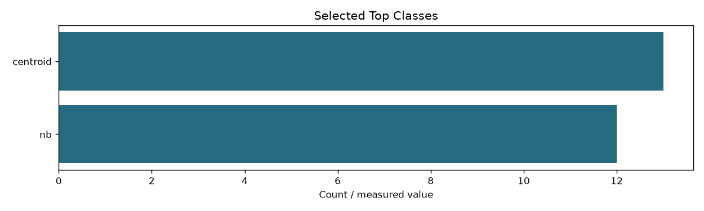
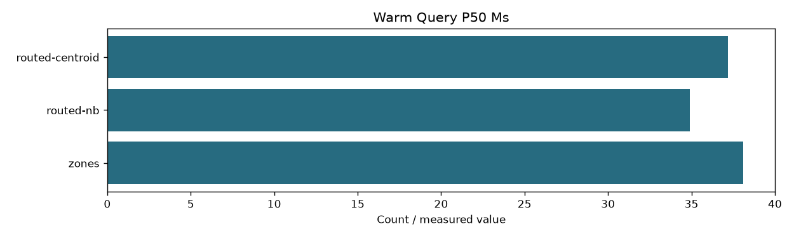

# 06 Category routing

```json
{
  "weights_sha256": "c95a78664256adfeff41ff2a4bf1891615d94be3f21086ce48d3d11464058f8f",
  "classifier_csv_sha256": "e9ff13c8df76535b2838baa4139264dfe1abd5a37583331bbba731a2409203bf",
  "index_fingerprint": "4217438d8fd32410fd22acf441c1c5403837c0fbb26a0f85edbdf1633eae0790",
  "top_classes": {
    "nb": 12,
    "centroid": 13
  },
  "validation_queries": [
    "DEV004",
    "DEV008",
    "DEV012",
    "DEV016",
    "DEV020",
    "DEV024",
    "DEV028",
    "DEV032",
    "DEV036",
    "DEV040",
    "DEV044"
  ],
  "selection_rule": "Smallest top-k classes with mean exact-zone top-20 recall >=0.98 and each query >=0.90",
  "recall": {
    "nb": {
      "1": 0.5863636363636363,
      "2": 0.6818181818181818,
      "3": 0.8545454545454546,
      "4": 0.8545454545454546,
      "5": 0.8636363636363636,
      "6": 0.8636363636363636,
      "7": 0.8863636363636364,
      "8": 0.8863636363636364,
      "9": 0.8863636363636364,
      "10": 0.890909090909091,
      "11": 0.890909090909091,
      "12": 1.0,
      "13": 1.0,
      "14": 1.0
    },
    "centroid": {
      "1": 0.7363636363636363,
      "2": 0.9454545454545454,
      "3": 0.9727272727272728,
      "4": 0.9727272727272728,
      "5": 0.9818181818181819,
      "6": 0.9818181818181819,
      "7": 0.9818181818181819,
      "8": 0.9818181818181819,
      "9": 0.9818181818181819,
      "10": 0.9818181818181819,
      "11": 0.9818181818181819,
      "12": 0.9818181818181819,
      "13": 1.0,
      "14": 1.0
    }
  },
  "candidate_fraction": {
    "nb": {
      "1": 0.04583059820291966,
      "2": 0.10101334920816313,
      "3": 0.1971871785944929,
      "4": 0.241544128394773,
      "5": 0.34849326427073674,
      "6": 0.4219909800492722,
      "7": 0.51519093646436,
      "8": 0.5901848903866035,
      "9": 0.6644945080353039,
      "10": 0.7561968974983855,
      "11": 0.8232671675388079,
      "12": 0.8789934011379915,
      "13": 0.9511530069602979,
      "14": 1.0
    },
    "centroid": {
      "1": 0.060062135076021116,
      "2": 0.1411327293456682,
      "3": 0.20186724142054926,
      "4": 0.2681335824405956,
      "5": 0.36580763639552777,
      "6": 0.4495464777278441,
      "7": 0.5170100750245165,
      "8": 0.6001908168716131,
      "9": 0.6884768402001717,
      "10": 0.7547710861944791,
      "11": 0.8318207065539482,
      "12": 0.8968884624890706,
      "13": 0.9483598519176032,
      "14": 1.0
    }
  },
  "meaning": "Recall of exhaustive weighted-zone top-20, not relevance Recall@20; validation is not a guarantee on new queries",
  "warm_query_p50_ms": {
    "zones": 38.11194500121928,
    "routed-nb": 34.914556999865454,
    "routed-centroid": 37.19156099941756
  }
}
```



