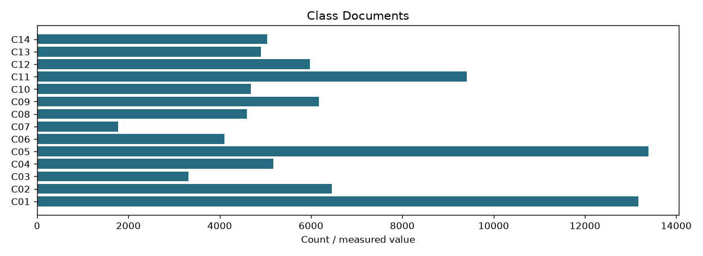

# Category vector row lists

```json
{
  "schema": "category-postings-v2",
  "index_fingerprint": "6243a1e92060be87bf31c54ccd305fb375d9d3482a75b317b51886ef24f198cf",
  "classifier_sha256": "7895b17e9113c09c0a5486e1b0be269445bf2d42fba83c84d940837c3bf3ae33",
  "default_top_classes": 3,
  "documents": 68414,
  "class_documents": {
    "C01": 13169,
    "C02": 6453,
    "C03": 3317,
    "C04": 5180,
    "C05": 13392,
    "C06": 4098,
    "C07": 1778,
    "C08": 4597,
    "C09": 6175,
    "C10": 4685,
    "C11": 9417,
    "C12": 5971,
    "C13": 4901,
    "C14": 5045
  },
  "meaning": "Configurable category pruning; no relevance-retention guarantee"
}
```

