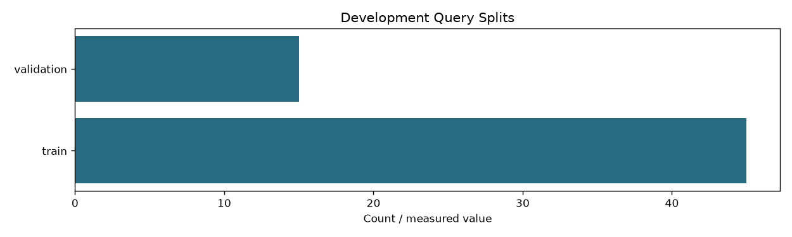
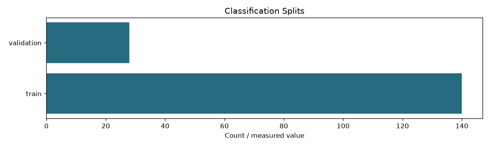
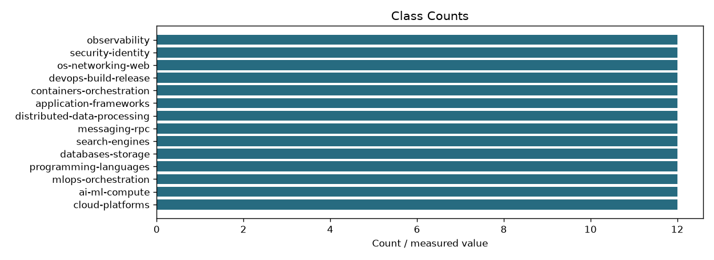

# Neural learning-data audit

```json
{
  "checks_passed": true,
  "zone_pairs": 240,
  "usable_zone_pairs": 240,
  "development_queries": 60,
  "query_splits": {
    "train": 45,
    "validation": 15
  },
  "classification_documents": 168,
  "classes": 14,
  "classification_splits": {
    "train": 140,
    "validation": 28
  },
  "query_scope": "Learning queries only; final benchmark queries live on the evaluation branch",
  "source_text_and_content_labels_checked": true,
  "classification_duplicate_group_leakage": false,
  "semantic_label_scope": "Binary query-specific development relevance; classification labels describe reviewed primary content topics. Structural checks do not prove judgment correctness.",
  "zone_training_sha256": "86c856c863c19dc1c63de31a7063a3f57ef0865afb95d3eb3230cfb7af66e33d",
  "classification_training_sha256": "eec3f80cecdace1470e4aeee2fbcafb3fc88e5ea62a8ce987c35c971d4b8f1d9"
}
```





