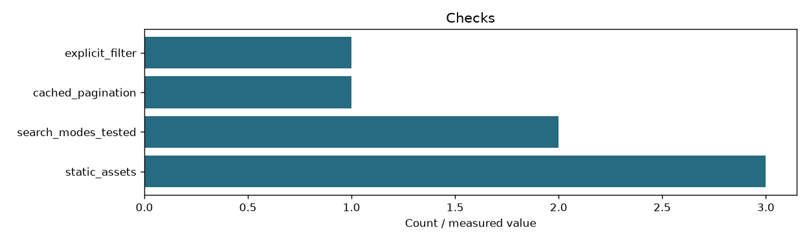

# Search UI verification

```json
{
  "static_assets_verified": true,
  "saved_html_verified": true,
  "viewer_sandbox_verified": true,
  "invalid_document_paths_rejected": true,
  "routed_filter_verified": true,
  "cached_pagination_verified": true,
  "default_categories": 3,
  "candidate_documents": 28442,
  "scanned_vectors": 175056,
  "query_elapsed_ms": 73.54
}
```

